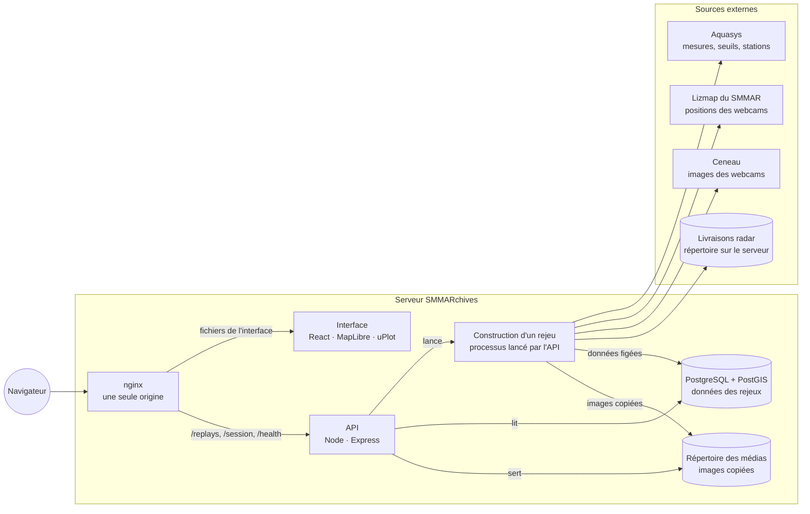
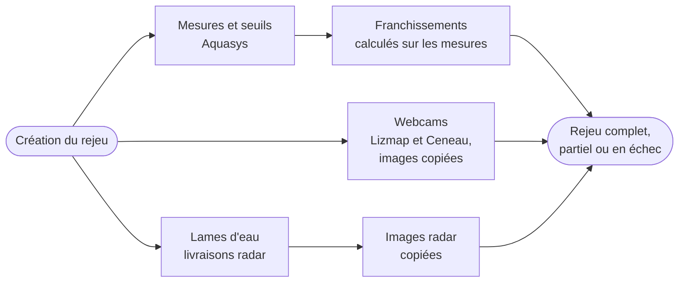

# Architecture

SMMARchives se compose d'une interface web, d'une API, d'une construction de
rejeu lancée par l'API, et d'un stockage : une base PostgreSQL avec PostGIS pour
les données, un répertoire pour les images. Le code est réparti en workspaces
npm sous `packages/`.

## Vue d'ensemble

- **L'interface ne parle qu'à l'API**, par des chemins relatifs : nginx sert ses
  fichiers et relaie vers l'API sur la même origine.
- **Seule la construction lit les sources.** L'API ne sert que ce qu'une
  construction a stocké : un rejeu ouvert ne déclenche aucun appel externe.
- **La construction est un processus à part**, lancé par l'API à la création
  d'un rejeu. Un redémarrage de l'API ne l'interrompt pas, et sa progression se
  lit dans le journal du rejeu.
- **Un rejeu est figé** : données, seuils et images sont copiés à la
  construction, et ne bougent plus ensuite. Seuls les événements saisis par un
  administrateur s'y ajoutent, s'y modifient ou s'en retirent.

## La construction d'un rejeu

- **Les trois sources se collectent en parallèle**, chacune dans sa voie :
  l'échec de l'une ne coûte que ses propres données.
- **Une voie ne tourne que si sa source est configurée.** Sans répertoire radar,
  les lames d'eau et leurs images sont absentes du rejeu, qui reste complet.
- **Les franchissements de seuils se calculent** sur les mesures et les seuils
  collectés : ils ne viennent d'aucune source.
- **L'état final** : complet quand tout a été collecté sans erreur, partiel
  quand une partie manque, en échec quand rien n'a pu être stocké. Seul un rejeu
  complet peut être publié.

## Les paquets

| Paquet | Contient |
|---|---|
| `packages/web` | L'interface : la carte, la chronologie, les graphiques, les formulaires |
| `packages/api` | Les routes HTTP, la session de l'administrateur, le lancement des constructions |
| `packages/worker` | Les lecteurs des sources, la construction d'un rejeu, le stockage dans PostgreSQL, les commandes `build:replay` et `migrate` |
| `packages/shared` | Les contrats de données partagés, l'horloge, la configuration, les tables de référence |

Le schéma de la base est dans `migrations/`, et ce qu'il demande à la base est
décrit dans [installation.md](installation.md#la-base-de-données). Les routes
de l'API sont décrites dans [api.md](api.md).
